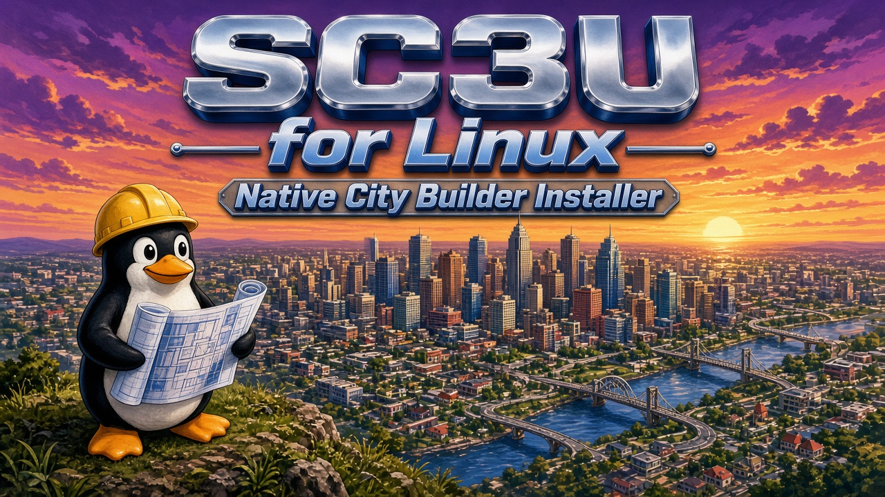
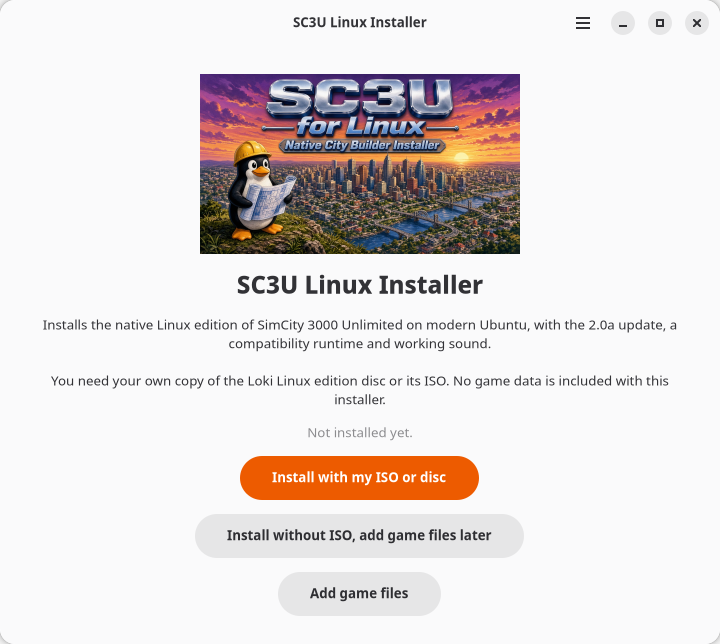

# SC3U Linux Installer

A native Linux installer for SimCity 3000 Unlimited, the Loki Software port from 2000. It is a friendly GTK4 app that builds a working install from your own disc or ISO on modern Ubuntu and Debian, with working PipeWire sound and gamescope fullscreen. **No game data is included.** You must own the game.



## Features

* Simple GTK4 / libadwaita GUI, no terminal needed
* Install with your ISO, disc or a folder of copied disc files
* Install without the ISO and use **Add game files** later
* Applies the Loki 2.0a update and compatibility runtime automatically
* One click sound fix: installs and starts `osspd` so the game has sound under PipeWire or PulseAudio
* gamescope fullscreen, with fit (black bars, correct shape) or stretch
* Resolution choice, defaulting to the sharpest one that fits your monitor
* Building Architect Tool included, with its own menu entry
* Per user install, no root needed except the optional sound fix
* Uninstall keeps your saved cities in `~/.loki/sc3u`

## Requirements

* Ubuntu or Debian (tested on Ubuntu 26.04, Wayland)
* Python 3.10 or newer with GTK4 (pulled in by the package)
* `gamescope` recommended for fullscreen
* Your own SimCity 3000 Unlimited Linux edition disc or ISO

## Install

Download `sc3u-linux-installer_0.1.0_all.deb` from [Releases](https://github.com/OldGrowthCrypto/sc3u-linux-installer/releases), then run:

```
sudo apt install ./sc3u-linux-installer_0.1.0_all.deb
```

## Usage

Open **SC3U Linux Installer** from your app grid. Choose your ISO (or install without it), pick your options and click Install. Then start **SimCity 3000 Unlimited** from the app grid or run `sc3u`. The Building Architect Tool is `sc3u-bat`.

It installs, per user:

| What | Where |
|---|---|
| Game folder | `~/.local/share/sc3u-linux/game` |
| Commands | `~/.local/bin/sc3u`, `~/.local/bin/sc3u-bat` |
| Menu entries | `~/.local/share/applications/` |
| Saved cities | `~/.loki/sc3u` (never removed) |

## Which disc files are needed

Copy these from the disc root into `~/.local/share/sc3u-linux/game`:

```
buildings/      whole folder
cities/         whole folder
res/            whole folder (you may keep only your language in res/text/)
plugin/         whole folder
barender/       whole folder, only for Building Architect
bacustom/       whole folder, only for Building Architect
sc3u.ini  snapshot.ini  hotkeys.txt  icon.xpm
sys/us/sys.pak  copy to  sys/sys.pak   (US English)
sys/eu/sys.pak  copy to  sys/sys.pak   (all other languages)
```

Do not copy `bin/` or `setup.data/`: the installer already has the updated 2.0a program. Empty folders such as
`res/sound/radio/stations` matter (the game otherwise asks for the CD); the installer recreates them.
Then open the installer, choose **Add game files** and **Check files copied into the game folder**. It applies update 2.0a
on top of them. Instead you can also copy the whole disc to any folder and pick that folder in Add game files.

## Command line

```
sc3u-linux-installer                      # GUI
sc3u-linux-installer --add-files          # GUI, straight to Add game files
sc3u-linux-installer cli validate FILE.iso
sc3u-linux-installer cli install [ISO|DIR] [--lang de] [--no-bat] [--no-intro]
sc3u-linux-installer cli add-files ISO|DIR|~/.local/share/sc3u-linux/game
sc3u-linux-installer cli status | files-to-copy | uninstall
```

Launcher options (environment): `SC3U_MODE=auto|gamescope|window|fullscreen`, `SC3U_RES=1280x1024`, `SC3U_AUDIO=auto|oss|none`,
`SC3U_INTRO=1`, `SC3U_CPUS=2`, `SC3U_BACKUPS=10`, `SC3U_GAMEDIR=...`. Log: `~/.loki/sc3u/last-run.log`.

## Troubleshooting

* **Black screen with sound:** use the default gamescope mode, or try `SC3U_MODE=window sc3u`. Avoid modes that change the screen resolution on Wayland.
* **No sound:** open the installer and click **Fix sound**, or run `sudo apt install osspd` and check that `/dev/dsp` exists. Then try `SC3U_AUDIO=oss sc3u`.
* **Not filling the screen:** install `gamescope`. The game tops out at 1280x1024, so on wide monitors fit mode shows black bars at the sides; choose stretch in the installer options if you prefer.
* Every run writes a log to `~/.loki/sc3u/last-run.log`.

## Build from source

Everything needed to build is in this repo: `src/`, `data/`, `payload/`, `tests/` and `tools/`.

```
sudo apt install python3 python3-gi gir1.2-gtk-4.0 gir1.2-adw-1 genisoimage dpkg-dev
git clone https://github.com/OldGrowthCrypto/sc3u-linux-installer.git
cd sc3u-linux-installer
python3 -m unittest discover -s tests       # run the tests
PYTHONPATH=src python3 -m sc3u_installer    # run the app from the tree
tools/build-deb.sh                          # builds dist/sc3u-linux-installer_<version>_all.deb
```

`tools/fetch-payload.sh` is a maintainer tool that regenerates `payload/` from the original 2.0a update archive; you do not need it for a normal build.

## Contributing

See [CONTRIBUTING.md](CONTRIBUTING.md). Bug reports and pull requests are welcome in Issues.

## Credits

* Loki Software, for the original Linux port and the 2.0a update
* The Linux gaming community, for years of notes on keeping Loki games running
* The gamescope and osspd projects

## License and trademarks

Our code is GPL-3.0-or-later, Copyright (C) 2026 Old Growth Crypto. See [COPYING](COPYING) and [NOTICE](NOTICE).

This project is not affiliated with or endorsed by Electronic Arts, Maxis or Loki Software. SimCity is a trademark of Electronic Arts Inc. No game data is included; you must own the game.
